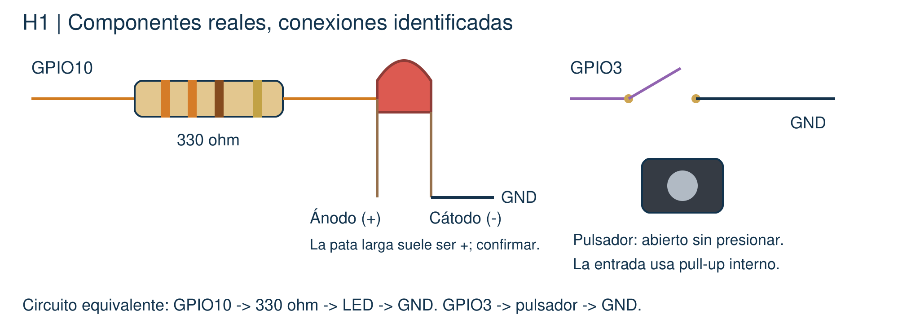

# 01 · Luz y botón

Encender una luz, cambiar su velocidad y usar un botón.

[Inicio](../README.md) · [Configuración](00_Empezar.md) · [Archivo listo para abrir](../Codigo/01_Luz_y_boton/01_Luz_y_boton.ino)

## 1. Conecta sin USB

| Terminal | Conexión |
| --- | --- |
| GPIO10 | 330 ohm -> ánodo LED; cátodo -> GND |
| GPIO3 | Botón normalmente abierto -> GND |

## 2. Copia todo o abre el archivo

Borra el programa anterior del editor. Usa un solo sketch.

```cpp
// Hecho por el profesor Francisco López Velázquez.
// zolvek.com.mx | K9 CALM - guia facil
#include <K9CalmAula.h>  // Biblioteca incluida en el curso.
K9CalmAula aula;         // Nuestro dispositivo.

const int PARPADEO_MS = 500; // Cambia SOLO este numero.

void setup() {               // Se ejecuta una vez.
  aula.iniciar(1);            // Prepara LED, boton y Serial.
}

void loop() {                // Se repite continuamente.
  aula.actualizar();          // Lee el boton sin detener el programa.
  aula.parpadear(PARPADEO_MS); // AUTO: enciende y apaga el LED.
  aula.mostrar();             // Muestra el modo cada 250 ms.
}
```

## 3. Qué hace cada cosa

| Código | Qué hace |
| --- | --- |
| iniciar(1) | Prepara LED, botón y monitor serie. |
| actualizar() | Atiende el botón; conserva el programa en marcha. |
| parpadear(...) | En AUTO, cambia la luz cada cierto tiempo. |
| mostrar() | Escribe modo:1 (AUTO) o modo:0 (MANUAL). |

## 4. Haz la prueba

1. Sube el programa. Abre Monitor serie a 115200. El LED parpadea.
2. Pulsa y suelta el botón: aparece modo:0. Es MANUAL.
3. Envía l (ele minúscula) desde el monitor: la luz cambia.
4. Pulsa otra vez: regresa a AUTO y vuelve el parpadeo.

## 5. Cambia un valor y vuelve a subir

| Valor | Cambio | Qué observar |
| --- | --- | --- |
| PARPADEO_MS | 500 -> 250 | Cambia más rápido; ciclo completo de 0.5 s. |
| PARPADEO_MS | 500 -> 1000 | Cambia más lento; ciclo completo de 2 s. |

**Si falla:** ¿No enciende? Revisa la polaridad del LED, la resistencia y GPIO10. ¿Siempre MANUAL? Revisa qué patas del botón están unidas.



LED con resistencia en serie y botón a tierra. El dibujo representa conexiones, no una fotografía.
