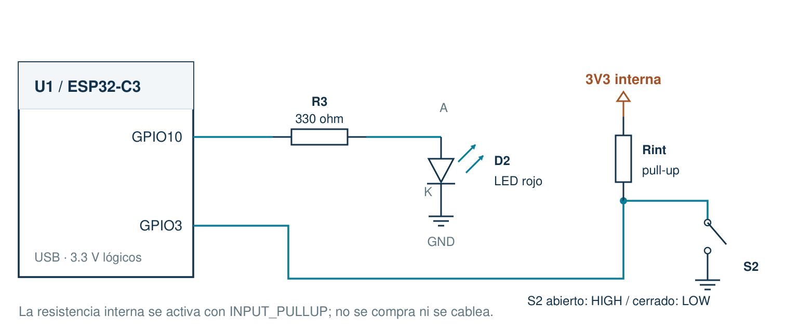

# 01 · Luz y botón

El ESP32 controla una luz. El botón cambia cómo la usamos.

[Inicio](../README.md) · [Configuración](00_Empezar.md) · [Archivo listo](../Codigo/01_Luz_y_boton/01_Luz_y_boton.ino)

## A · Conecta y comprueba

Con USB retirado: LED, resistencia de 330 ohm y pulsador.



| Desde | Conecta hasta |
| --- | --- |
| GPIO10 | 330 ohm -> ánodo del LED |
| Cátodo del LED | GND |
| GPIO3 | Un lado del pulsador |
| Otro lado del pulsador | GND |

El LED necesita una resistencia para limitar corriente. El botón conecta GPIO3 a GND al pulsarlo; la placa detecta ese cambio.

Revisa el LED: el cátodo suele ser la pata corta y el lado plano. Comprueba los pares del botón con continuidad, sin USB. Rint del plano ya está dentro del ESP32: no la compres.

**Comprobación:** Conecta USB y mide entre 3V3 y GND: cerca de 3.3 V. No unas 3V3 con GND. Si hay calor o reinicios, retira USB y revisa.

## B · Copia el programa completo

Abre el archivo o borra el editor y pega todo. No lo agregues debajo del código anterior.

```cpp
// Hecho por el profesor Francisco López Velázquez.
// zolvek.com.mx | K9 CALM - guia facil
#include <K9CalmAula.h>  // Biblioteca incluida en el curso.
K9CalmAula aula;         // Nuestro dispositivo.

const int PARPADEO_MS = 500; // Cambia SOLO este numero.

void setup() {               // Se ejecuta una vez.
  aula.iniciar(1);            // Prepara LED, boton y Serial.
}

void loop() {                // Se repite continuamente.
  aula.actualizar();          // Lee el boton sin detener el programa.
  aula.parpadear(PARPADEO_MS); // AUTO: enciende y apaga el LED.
  aula.mostrar();             // Muestra el modo cada 250 ms.
}
```

| Línea o función | Qué hace |
| --- | --- |
| const int PARPADEO_MS = 500; | Un número entero: fija 500 ms entre cambios de luz. |
| setup() / iniciar(1) | Prepara el equipo una vez, al encender. |
| loop() / actualizar() | Repite el trabajo y atiende el botón. |
| parpadear() / mostrar() | Controla la luz y escribe el modo. |

### Ejemplo antes de probar

| Caso | Cómo se interpreta |
| --- | --- |
| El tiempo del programa | 0 ms -> 500 ms -> 1000 ms |
| El LED en AUTO | apagado -> encendido -> apagado |

## C · Observa, predice y cambia

1. **Carga y mira.** Verificar > Subir. Abre Monitor serie a 115200. El LED cambia cada medio segundo.
2. **Pulsa una vez.** Debe aparecer MANUAL y modo:0. Mantener pulsado no debe alternar continuamente.
3. **Manda una orden.** En MANUAL, escribe l (ele minúscula) y envía. La luz cambia. Vuelve a pulsar: AUTO.

Fragmentos ilustrativos de salida; tus números pueden variar:

```text
modo:1
MANUAL
modo:0
```

### Cambia PARPADEO_MS

| Prueba | Qué comparar |
| --- | --- |
| 500 | 1.0 s por ciclo completo |
| 250 | 0.5 s por ciclo completo |
| 1000 | 2.0 s por ciclo completo |

Un ciclo incluye encender y apagar. Por eso 500 ms entre cambios producen un ciclo de 1000 ms.

**Si falla:** Si no prende, prueba MANUAL + l. Revisa LED al revés, resistencia y GPIO10. Si el botón nunca cambia, revisa sus pares de patas.

**Registra:** cambié ___; predije ___; observé ___. Avanza cuando puedas repetirlo y explicar por qué cambió la salida.
