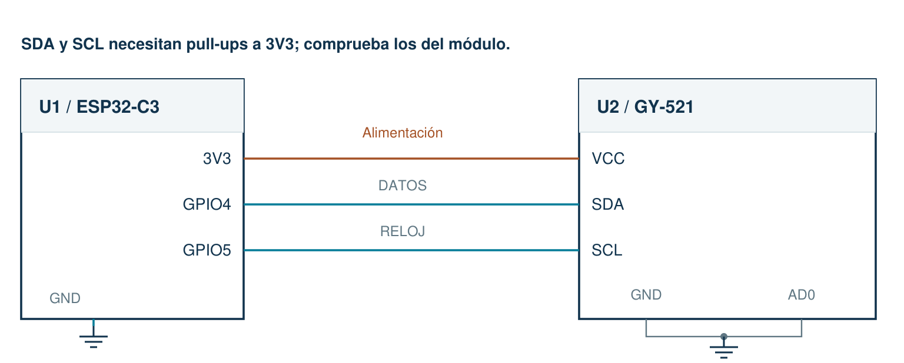

# 02 · Medir movimiento

Primero observa un número; después úsalo para decidir si prende el LED.

[Inicio](../README.md) · [Configuración](00_Empezar.md) · [Archivo listo](../Codigo/02_Movimiento/02_Movimiento.ino)

## A · Conecta y comprueba

Con USB retirado: Módulo GY-521 / MPU6050. Conserva LED y botón.



| Desde | Conecta hasta |
| --- | --- |
| VCC / GND del GY-521 | 3V3 / GND del ESP32 |
| SDA / SCL del GY-521 | GPIO4 / GPIO5 |
| AD0 | GND: dirección 0x68 |
| XDA, XCL e INT | Dejar sin conectar |

El acelerómetro mide en tres ejes. La biblioteca resume el cambio en act. Una act pequeña indica poca variación; un umbral decide cuándo avisar. No mide miedo.

SDA lleva datos y SCL sincroniza la conversación. Ambos necesitan pull-ups a 3V3; muchos módulos ya los traen. Alimenta el módulo con 3V3 y comprueba que sea compatible.

**Comprobación:** Con USB, mide VCC-GND en el sensor. SDA y SCL en reposo deben estar cerca de 3.3 V, nunca 5 V. Después, el programa debe encontrar 0x68.

## B · Copia el programa completo

Abre el archivo o borra el editor y pega todo. No lo agregues debajo del código anterior.

```cpp
// Hecho por el profesor Francisco López Velázquez.
// zolvek.com.mx | K9 CALM - guia facil
#include <K9CalmAula.h>  // Biblioteca incluida en el curso.
K9CalmAula aula;         // Nuestro dispositivo.

const float UMBRAL_MOV = 0.70; // Menor = mas sensible.

void setup() {
  aula.iniciar(2);             // Conserva P1 y agrega MPU6050.
}

void loop() {
  aula.actualizar();           // Lee boton y movimiento.
  bool seMueve = aula.actividad() > UMBRAL_MOV;
  aula.encender(seMueve);      // AUTO: LED si supera el umbral.
  aula.mostrar();              // a, giro y act en el monitor.
}
```

| Línea o función | Qué hace |
| --- | --- |
| const float UMBRAL_MOV = 0.70; | float guarda decimales. 0.70 es el umbral en m/s². |
| aula.actividad() | Obtiene la última actividad calculada. |
| actividad() > UMBRAL_MOV | Pregunta: ¿el número es mayor que 0.70? |
| bool seMueve / encender(seMueve) | bool guarda sí/no. En AUTO, ese resultado controla la luz. |

### Ejemplo antes de probar

| Caso | Cómo se interpreta |
| --- | --- |
| Ejemplo quieto | act = 0.12; 0.12 > 0.70 es NO -> LED apagado |
| Ejemplo en movimiento | act = 1.10; 1.10 > 0.70 es SÍ -> LED encendido |

## C · Observa, predice y cambia

1. **Espera en la mesa.** Sube P2 y espera 5 s sin tocarlo. Busca I2C 0x68 e IMU:1. La magnitud a debe aproximarse a 9.81.
2. **Mueve el objeto.** Fija el sensor a un objeto o peluche. Muévelo suave, sin golpear: act aumenta. El LED avisa si supera el umbral.
3. **Déjalo quieto otra vez.** act debe disminuir. Prueba también el botón: MANUAL sigue disponible.

Fragmentos ilustrativos de salida; tus números pueden variar:

```text
I2C 0x68
modo:1 a:9.81 giro:0.02 act:0.12 IMU:1
```

### Cambia UMBRAL_MOV

| Prueba | Qué comparar |
| --- | --- |
| 0.30 | Más sensible a pequeños cambios |
| 0.70 | Valor de partida |
| 1.20 | Exige mayor actividad |

La lectura act no cambia porque cambies el umbral; cambia la decisión. La misma act=0.50 prende con 0.30 y no prende con 0.70.

**Si falla:** Sin 0x68 o con IMU:0, revisa 4/SDA, 5/SCL, AD0 y GND. No interpretes act=0 como reposo si no hay datos recientes.

**Registra:** cambié ___; predije ___; observé ___. Avanza cuando puedas repetirlo y explicar por qué cambió la salida.
