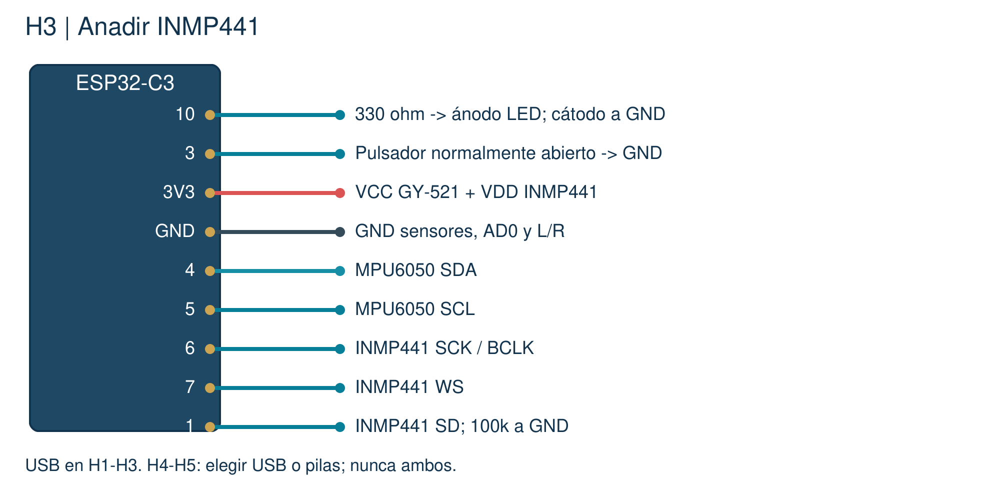

# 03 · Detectar un sonido

Encender una alerta al detectar un sonido brusco, conservando el movimiento.

[Inicio](../README.md) · [Configuración](00_Empezar.md) · [Archivo listo para abrir](../Codigo/03_Sonido/03_Sonido.ino)

## 1. Conecta sin USB

| Terminal | Conexión |
| --- | --- |
| Conserva P2 | No cambies los cables anteriores. |
| INMP441 | VDD -> 3V3; GND y L/R -> GND; SCK -> 6; WS -> 7; SD -> 1 |
| Resistencia de SD | 100 kohm entre SD y GND; desacoplo 100 nF si falta en módulo. |

## 2. Copia todo o abre el archivo

Borra el programa anterior del editor. Usa un solo sketch.

```cpp
// Hecho por el profesor Francisco López Velázquez.
// zolvek.com.mx | K9 CALM - guia facil
#include <K9CalmAula.h>  // Biblioteca incluida en el curso.
K9CalmAula aula;         // Nuestro dispositivo.

const float UMBRAL_MOV = 0.70;
const float UMBRAL_SONIDO = 0.004; // Menor = detecta sonidos mas suaves.
const int ALERTA_MS = 1000;        // Duracion de la luz.

void setup() {
  aula.ajustarSonido(UMBRAL_SONIDO);
  aula.iniciar(3);                  // Conserva P2 y agrega microfono.
}

void loop() {
  aula.actualizar();                // Lee ambos sensores y boton.
  if (aula.impulso()) {             // Detecto un sonido brusco.
    aula.alertar(ALERTA_MS);        // Guarda la alerta sin usar delay.
  }
  aula.encender(aula.actividad() > UMBRAL_MOV);
  aula.mostrar();                   // Observa act, rms y pico.
}
```

## 3. Qué hace cada cosa

| Código | Qué hace |
| --- | --- |
| ajustarSonido(...) | Fija el mínimo de sonido para la prueba. |
| iniciar(3) | Agrega el micrófono digital al montaje anterior. |
| impulso() | Responde sí durante la detección de un sonido brusco. |
| alertar(ALERTA_MS) | Mantiene la luz por ese tiempo sin detener sensores. |

## 4. Haz la prueba

1. Sube P3 y espera 3 s con ambiente tranquilo.
2. Habla suave: rms y pico cambian. No deben quedar en cero siempre.
3. Reproduce una palmada grabada a volumen moderado; espera 3 s entre intentos.
4. Mueve el objeto: act sigue cambiando. El botón conserva AUTO/MANUAL.

## 5. Cambia un valor y vuelve a subir

| Valor | Cambio | Qué observar |
| --- | --- | --- |
| UMBRAL_SONIDO | 0.004 -> 0.008 | Sube el mínimo: puede detectar menos eventos. |
| UMBRAL_SONIDO | 0.004 -> 0.002 | Baja el mínimo; el filtro de ruido también influye. |
| ALERTA_MS | 1000 -> 1500 | La luz de alerta dura 1.5 s. |

**Si falla:** ¿rms siempre cero? Revisa SD=1 y L/R=GND. ¿pico cerca de 1 siempre? Baja volumen y revisa conexiones. rms no representa dB.



SCK y WS son relojes; SD trae el audio digital. I2S ya viene configurado en la biblioteca de aula.
