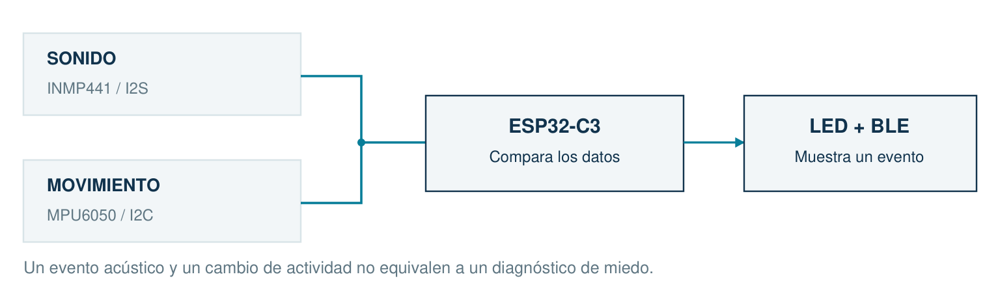

# 04 · Ver datos en el teléfono

Lleva el mismo estado del monitor serie al teléfono.

[Inicio](../README.md) · [Configuración](00_Empezar.md) · [Archivo listo](../Codigo/04_Bluetooth/04_Bluetooth.ino)

## A · Conecta y comprueba

Con USB retirado: No agregues cables. El C3 ya tiene Bluetooth Low Energy.



| Desde | Conecta hasta |
| --- | --- |
| Sensores, LED y botón | Exactamente como en P3 |
| Alimentación | USB como única fuente |
| GPIO0 | Libre; MEDIR_DIVISOR=false |
| Portapilas y motor | No se conectan en esta guía |

BLE publica un servicio y dos características: un dato de estado y otro de voltaje. La app consulta o se suscribe. No necesita internet para ese enlace.

No añadas una tarjeta Bluetooth: ya está integrada. Usa nRF Connect for Mobile de Nordic Semiconductor. La cuenta o la nube no forman parte de la práctica.

**Comprobación:** Primero comprueba que P3 funciona. Si cambiaste valores, anótalos. Para empezar P4 usa los valores que aparecen en el archivo entregado.

## B · Copia el programa completo

Abre el archivo o borra el editor y pega todo. No lo agregues debajo del código anterior.

```cpp
// Hecho por el profesor Francisco López Velázquez.
// zolvek.com.mx | K9 CALM - guia facil
#include <K9CalmAula.h>  // Biblioteca incluida en el curso.
K9CalmAula aula;         // Nuestro dispositivo.

const float UMBRAL_MOV = 0.70;
const float UMBRAL_SONIDO = 0.004;
const int ALERTA_MS = 1000;
const bool MEDIR_DIVISOR = false; // Dejar false en USB normal.
const float CALIBRACION = 1.000;  // Cambiar solo al medir con multimetro.

void setup() {
  aula.ajustarSonido(UMBRAL_SONIDO);
  aula.prepararMedicion(MEDIR_DIVISOR, CALIBRACION);
  aula.iniciar(4);                // Conserva P3 y agrega BLE.
}

void loop() {
  aula.actualizar();              // Tambien mide ADC si fue habilitado.
  if (aula.impulso()) aula.alertar(ALERTA_MS);
  aula.encender(aula.actividad() > UMBRAL_MOV);
  aula.enviar();                  // Estado y voltaje para nRF Connect.
  aula.mostrar();                 // Comprueba tambien en la PC.
}
```

| Línea o función | Qué hace |
| --- | --- |
| prepararMedicion(false,...) | Deja el ADC opcional apagado durante USB normal. |
| iniciar(4) | Conserva P3 y agrega el servicio BLE. |
| aula.enviar() | Actualiza estado cada 500 ms cuando corresponde. |
| aula.mostrar() | Mantiene el monitor serie para comparar con el teléfono. |

### Ejemplo antes de probar

| Caso | Cómo se interpreta |
| --- | --- |
| A E1 B0 Q0 | Automático / último impulso / USB o normal / puntuación 0 |
| M E1 B0 Q0 | El botón cambia A a M; en P4 E1 queda hasta reiniciar |

## C · Observa, predice y cambia

1. **Escanea y conecta.** Abre nRF Connect: Scanner > Scan > K9-CALM > Connect. Concede permisos de dispositivos cercanos si Android los pide.
2. **Lee una característica.** Expande el servicio 8d6c0001. En 0002 pulsa Read y elige texto UTF-8. Activa su suscripción para recibir cambios.
3. **Compara dos pantallas.** Pulsa el botón: A cambia a M. Lee 0003: USB; NA. En la computadora, modo también cambia.

Fragmentos ilustrativos de salida; tus números pueden variar:

```text
A E1 B0 Q0
M E1 B0 Q0
USB; NA
```

### Cambia Un valor por vez

| Prueba | Qué comparar |
| --- | --- |
| 1000 -> 500 | ALERTA_MS: la luz dura menos |
| 0.004 -> 0.008 | UMBRAL_SONIDO: cambia la detección |
| false | MEDIR_DIVISOR: mantener así en USB normal |

La transmisión BLE no enciende por sí sola una notificación del sistema operativo. Debes permanecer conectado y suscrito dentro de la app.

**Si falla:** Si no aparece, revisa permisos y desconecta otros teléfonos. Si puedes leer pero no llegan cambios, activa la suscripción de 0002.

**Registra:** cambié ___; predije ___; observé ___. Avanza cuando puedas repetirlo y explicar por qué cambió la salida.
