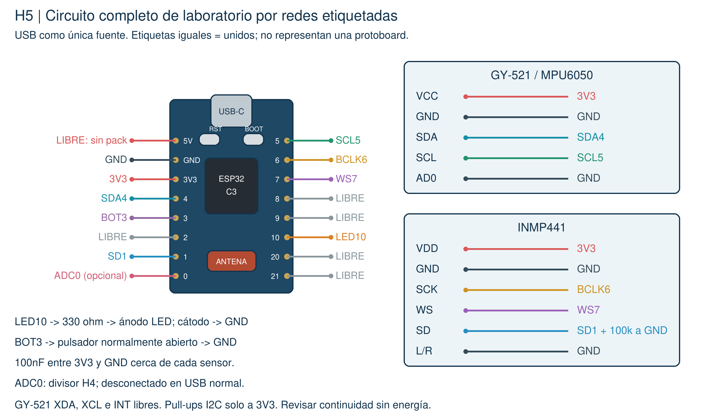

# 04 · Ver datos en el teléfono

Consultar el modo y las alertas por Bluetooth Low Energy (BLE).

[Inicio](../README.md) · [Configuración](00_Empezar.md) · [Archivo listo para abrir](../Codigo/04_Bluetooth/04_Bluetooth.ino)

## 1. Conecta sin USB

| Terminal | Conexión |
| --- | --- |
| Conserva P3 | Todo sigue por USB. No conectes el portapilas. |
| GPIO0 / divisor | Déjalo sin conectar en esta primera prueba; MEDIR_DIVISOR=false. |

## 2. Copia todo o abre el archivo

Borra el programa anterior del editor. Usa un solo sketch.

```cpp
// Hecho por el profesor Francisco López Velázquez.
// zolvek.com.mx | K9 CALM - guia facil
#include <K9CalmAula.h>  // Biblioteca incluida en el curso.
K9CalmAula aula;         // Nuestro dispositivo.

const float UMBRAL_MOV = 0.70;
const float UMBRAL_SONIDO = 0.004;
const int ALERTA_MS = 1000;
const bool MEDIR_DIVISOR = false; // Dejar false en USB normal.
const float CALIBRACION = 1.000;  // Cambiar solo al medir con multimetro.

void setup() {
  aula.ajustarSonido(UMBRAL_SONIDO);
  aula.prepararMedicion(MEDIR_DIVISOR, CALIBRACION);
  aula.iniciar(4);                // Conserva P3 y agrega BLE.
}

void loop() {
  aula.actualizar();              // Tambien mide ADC si fue habilitado.
  if (aula.impulso()) aula.alertar(ALERTA_MS);
  aula.encender(aula.actividad() > UMBRAL_MOV);
  aula.enviar();                  // Estado y voltaje para nRF Connect.
  aula.mostrar();                 // Comprueba tambien en la PC.
}
```

## 3. Qué hace cada cosa

| Código | Qué hace |
| --- | --- |
| iniciar(4) | Agrega BLE a las funciones anteriores. |
| prepararMedicion(false,...) | Deja apagada la medición de voltaje mientras usas USB normal. |
| enviar() | Publica estado y permite consultarlo desde nRF Connect. |
| mostrar() | También mantiene los datos en el monitor de la computadora. |

## 4. Haz la prueba

1. Sube P4. Instala y abre nRF Connect for Mobile de Nordic.
2. Scan -> K9-CALM -> Connect. Expande el servicio 0001.
3. Lee 0002 como texto; activa su suscripción a notificaciones.
4. Pulsa el botón: cambia A/M. Lee 0003: debe decir USB; NA.

## 5. Cambia un valor y vuelve a subir

| Valor | Cambio | Qué observar |
| --- | --- | --- |
| UMBRAL_SONIDO | 0.004 -> 0.008 | Compara cuántos eventos E1 llegan al teléfono. |
| ALERTA_MS | 1000 -> 500 | La luz dura medio segundo; BLE sigue actualizando. |

**Si falla:** ¿No aparece? Revisa permisos Bluetooth/dispositivos cercanos y que otro teléfono no esté conectado. ¿No llegan cambios? Activa la suscripción en 0002.



Montaje completo por USB. El divisor de GPIO0 se prueba después, con la guía de medición.
