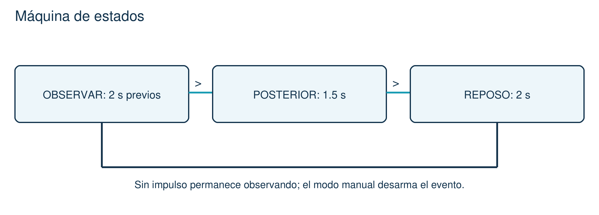

# 05 · El detector completo

Comparar sonido y movimiento antes y después; mostrar una categoría experimental.

[Inicio](../README.md) · [Configuración](00_Empezar.md) · [Archivo listo para abrir](../Codigo/05_Detector_completo/05_Detector_completo.ino)

## 1. Conecta sin USB

| Terminal | Conexión |
| --- | --- |
| Conserva P4 | Mismo montaje, mismos pines y USB como única fuente. |
| Sin motor | Esta guía no conecta motores ni coloca el prototipo en animales. |

## 2. Copia todo o abre el archivo

Borra el programa anterior del editor. Usa un solo sketch.

```cpp
// Hecho por el profesor Francisco López Velázquez.
// zolvek.com.mx | K9 CALM - guia facil
#include <K9CalmAula.h>  // Biblioteca incluida en el curso.
K9CalmAula aula;         // Nuestro dispositivo.

const float UMBRAL_SONIDO = 0.004;
const float CAMBIO_MOV = 0.70;     // Diferencia minima despues del sonido.
const bool MEDIR_DIVISOR = false; // USB: false. Medicion guiada: true.
const float CALIBRACION = 1.000;

void setup() {
  aula.ajustarSonido(UMBRAL_SONIDO);
  aula.ajustarCambio(CAMBIO_MOV);
  aula.prepararMedicion(MEDIR_DIVISOR, CALIBRACION);
  aula.iniciar(5);                // Conserva todo lo anterior.
}

void loop() {
  aula.actualizar();              // Sigue leyendo aunque haya alerta.
  aula.compararEvento();          // Compara 2 s antes y 1.5 s despues.
  aula.encender(aula.evento() == 2); // LED: posible reaccion.
  aula.enviar();                  // Envia E0, E1, E2 o E3 por BLE.
  aula.mostrar();                 // Muestra categoria y puntuacion.
}
```

## 3. Qué hace cada cosa

| Código | Qué hace |
| --- | --- |
| ajustarCambio(...) | Fija la diferencia mínima de actividad para comparar. |
| iniciar(5) | Conserva sensores, botón, LED, BLE y ADC opcional. |
| compararEvento() | Guarda 2 s previos y observa 1.5 s posteriores. |
| evento() == 2 | Pregunta si hubo un posible cambio de reacción. |
| enviar() / mostrar() | Presentan E0, E1, E2 o E3 y una puntuación de ensayo. |

## 4. Haz la prueba

1. Sube P5 y espera 5 s sin mover el objeto.
2. Sonido moderado sin mover: espera E1 si se detecta impulso.
3. Repite y mueve el objeto después del sonido: puede aparecer E2.
4. Pon MANUAL: sigue midiendo y enviando, pero deja de clasificar.

## 5. Cambia un valor y vuelve a subir

| Valor | Cambio | Qué observar |
| --- | --- | --- |
| CAMBIO_MOV | 0.70 -> 0.30 | Reduce el mínimo de cambio; la variación previa también cuenta. |
| CAMBIO_MOV | 0.70 -> 1.20 | Aumenta el mínimo: exige más cambio de actividad. |
| UMBRAL_SONIDO | 0.004 -> 0.008 | Sube el mínimo acústico; compara sin cambiar volumen. |

**Si falla:** ¿Siempre E1? Observa act y mueve el objeto después del sonido. ¿E3? Espera 5 s y revisa IMU/MIC. No elimines los controles de calidad.



Espera datos, observa después del sonido y deja 2 s de reposo para no contar varias veces el mismo evento.
