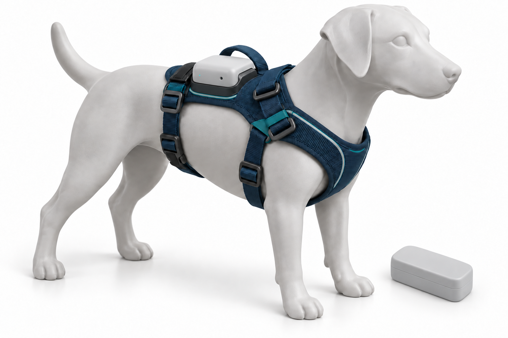

# K9 CALM · Guía fácil de laboratorio

**Hecho por el profesor Francisco López Velázquez.**

[**zolvek.com.mx**](https://zolvek.com.mx) · Electrónica básica para preparatoria · ESP32-C3

*Ilustración conceptual generada con IA. No es un montaje probado ni un plano de conexión.*

## Empieza con esto

1. En esta página pulsa **Code > Download ZIP** y extrae la carpeta.
2. Abre la [Guía fácil en PDF](output/pdf/K9_Calm/Manual_K9_Calm_Guia_Facil.pdf).
3. Sigue [00 · Instalar Arduino y las bibliotecas](Guia/00_Empezar.md). Las siete bibliotecas del curso **ya vienen incluidas**.
4. Arma solamente el LED y el botón, abre [P1](Codigo/01_Luz_y_boton/01_Luz_y_boton.ino), sube y prueba.
5. Haz las prácticas en orden. Cada una conserva lo que ya funciona.

[**Descargar paquete completo de la entrega**](https://github.com/f-lopez-velazquez/K9-CALM/releases/latest) · [**Manual completo de consulta**](output/pdf/K9_Calm/Manual_K9_Calm.pdf)

## Cinco prácticas: conecta, pega, prueba y cambia

| Práctica | Qué construyes | Instrucciones paso a paso | Código completo |
|---|---|---|---|
| 1 | LED y botón AUTO/MANUAL | [Luz y botón](Guia/01_Luz_y_boton.md) | [Abrir .ino](Codigo/01_Luz_y_boton/01_Luz_y_boton.ino) |
| 2 | Detector de movimiento | [Movimiento](Guia/02_Movimiento.md) | [Abrir .ino](Codigo/02_Movimiento/02_Movimiento.ino) |
| 3 | Alerta por sonido brusco | [Sonido](Guia/03_Sonido.md) | [Abrir .ino](Codigo/03_Sonido/03_Sonido.ino) |
| 4 | Datos en el teléfono | [Bluetooth](Guia/04_Bluetooth.md) | [Abrir .ino](Codigo/04_Bluetooth/04_Bluetooth.ino) |
| 5 | Comparación antes/después | [Detector completo](Guia/05_Detector_completo.md) | [Abrir .ino](Codigo/05_Detector_completo/05_Detector_completo.ino) |

No combines los cinco archivos dentro de una misma carpeta. Abre una sola práctica. Si copias desde GitHub, usa el botón de copiar del bloque; si copias desde el PDF, el código no tiene números de línea.

## Compra lo necesario

La [lista de materiales de la guía fácil](Guia/Materiales.md) distingue el material necesario del opcional. Para terminar necesitas:

- ESP32-C3 SuperMini USB-C, 16 pines y flash de 4 MB.
- Cable USB de **datos**, protoboard, cables y cabeceras soldadas.
- LED rojo, resistencia **330 ohm** y pulsador normalmente abierto.
- **MPU6050/GY-521** compatible con 3.3 V.
- **INMP441** digital I2S y resistencia de **100 kohm** de SD a GND.
- Dos desacoplos **100 nF** si los módulos no los incluyen.
- Multímetro compartido, computadora y Android con BLE.

**No necesitas pantalla, motor ni pilas para completar la guía fácil.** El divisor opcional usa otra resistencia de **100 kohm**, una de **150 kohm** y otro **100 nF**. No confundas esa resistencia de 100k con la de SD: son dos piezas si montas todo.

[Pinout](Diagramas/01_pinout.png) · [Circuito completo por redes](Diagramas/14_laboratorio.png) · [Materiales del manual completo, CSV](Lista_de_Materiales.csv)

## Lo que ya viene aquí

- Programas cortos de **15-25 líneas aproximadamente**, con comentarios y valores para cambiar.
- Biblioteca **K9CalmAula 1.0.0**, con [fuente completa](Biblioteca/K9CalmAula/src/) y [explicación](Guia/Biblioteca_por_dentro.md).
- Seis bibliotecas de terceros, en ZIP originales con sus avisos y licencias: MPU6050 2.2.9, BusIO 1.17.4, Unified Sensor 1.1.15, GFX 1.13.0, SSD1306 2.5.17 y NimBLE-Arduino 2.5.2.
- [Archivo para instalar todas](Librerias/Instalar_todas.zip), [ZIP individuales](Librerias/ZIP/) y [sumas SHA-256](Librerias/SHA256.json).
- Dos PDF, esquemas SVG editables, imágenes, pasos de prueba y solución de problemas.
- [Código de referencia completo](Codigo_Referencia/) para estudiar la implementación sin la ayuda de aula.

**Se instala aparte, desde fuentes oficiales:** Arduino IDE 2.x; soporte **esp32 by Espressif Systems 3.3.4** con herramientas para tu sistema; nRF Connect for Mobile de Nordic. Se necesita internet para esa instalación inicial. No se promete un paquete completamente desconectado de internet ni se distribuyen controladores sin identificar la placa.

## Qué debe hacer

Botón: cambia AUTO/MANUAL. En MANUAL, envía `l` por Serial para conmutar el LED. P5 desarma la clasificación en MANUAL y conserva lectura de sensores y BLE. `MEDIR_DIVISOR=false` es la configuración normal por USB.

P5 compara actividad previa con movimiento posterior a un impulso y publica:

| Código | Significado |
|---|---|
| E0 | Sin evento pendiente según este detector |
| E1 | Evento acústico sospechoso |
| E2 | Posible cambio de reacción después del sonido |
| E3 | Información insuficiente tras un impulso |

BLE: `A E2 B0 Q80` es modo AUTO, categoría E2, estado de alimentación B0 y puntuación experimental 80. Q **no es probabilidad de miedo**. B0 puede indicar USB; lee la característica de voltaje para distinguirlo.

## ¿La vibración va en el pecho?

**La evidencia encontrada no permite indicar pecho, espalda o ambos como ubicación terapéutica para calmar perros.** Los papers de chalecos vibratorios estudian principalmente comunicación aprendida; presión y vibración son intervenciones diferentes. No se identificó una pauta validada por raza, peso, Hz o duración para el objetivo de calmar.

Lee el [informe de evidencia con papers y límites](Guia/Evidencia_vibracion_y_bienestar.md). La guía no activa vibración sobre animales. La caja dorsal de la imagen es un alojamiento conceptual, no una recomendación terapéutica. Motor opcional: solamente mesa o peluche.

## Verificación y alcance

[Resultados de compilación](Verificacion/compilacion_aula.json) · [Registros](Verificacion/) · [Fuentes y licencias](Referencias.md)

Los sketches de aula se verifican para `esp32:esp32:esp32c3:CDCOnBoot=cdc` y contra las bibliotecas **extraídas del paquete incluido**, sin tomar bibliotecas instaladas por el usuario. Compilar no demuestra funcionamiento físico. No se hicieron pruebas con hardware, sensores, alimentación AAA ni animales.

Prueba sonidos grabados a volumen moderado y movimientos simulados en mesa o peluche. El proyecto no diagnostica ni trata miedo. Tres AAA no se conectan a 3V3; el modo portátil del manual completo exige identificar el regulador y medir estabilidad. Nunca USB y pack simultáneos.

## Para el profesor

- [Biblioteca por dentro](Guia/Biblioteca_por_dentro.md): qué hace cada etapa y cómo se calcula el evento.
- [Manual completo](output/pdf/K9_Calm/Manual_K9_Calm.pdf): teoría, FFT, batería, motor de banco y código extenso.
- [Guía fácil](output/pdf/K9_Calm/Manual_K9_Calm_Guia_Facil.pdf): ruta principal para el alumno.
- [Reproducir los PDF y las compilaciones](Guia/Reproducir.md).

Los códigos y textos originales se publican para uso, copia y modificación conforme a [LICENCIA_PROYECTO.md](LICENCIA_PROYECTO.md). Las bibliotecas externas conservan sus propias licencias; no se atribuyen al profesor.
